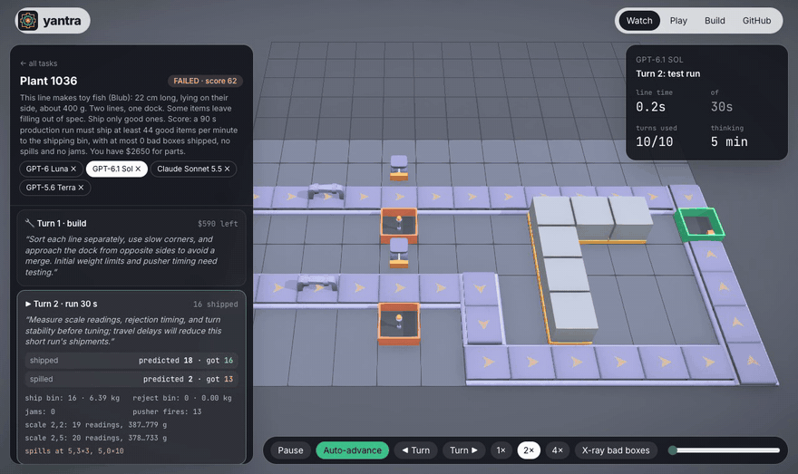

<p align="center">
  <picture>
    <source media="(prefers-color-scheme: dark)" srcset="assets/logo-dark.svg">
    
  </picture>
</p>

<p align="center">
  <b>AI agents build, test and fix factories on real physics.</b><br>
  Place belts, scales and pushers. Run the line. Watch boxes spill and jam. Fix it. Hand it over for a scored production run.
</p>

<p align="center">
  
  
  
  
</p>

<p align="center">
  
</p>

*Yantra* (यन्त्र) is Sanskrit for a machine, and for the geometric diagram drawn as a square with four gates. This one is both.

---

## What it is

A benchmark and RL environment where an agent has to **engineer a physical system over many turns**: build something, run it, read what really happened, find the hidden cause, and fix it. Success is measured by the simulator, not by a judge model.

Most physics benchmarks are single-shot puzzles or questions about videos. Here the agent acts, and the world pushes back:

- a box going too fast overshoots a turn and hits the rail,
- two boxes on a scale at once read as one heavy box,
- a pusher fires at the right box but too late, and knocks it into the wrong bin,
- a toy cow on a fast belt tips over and jams the line behind it.

None of that is scripted. It falls out of MuJoCo contact physics, and the agent can only learn the plant's hidden properties (belt grip, pusher speed and valve delay, load-cell noise, what the filler actually sends) by running experiments.

**Who it's for**

| | |
|---|---|
| **AI labs and eval teams** | A score for multi-turn physical engineering: plan, test, diagnose, fix. Every result is checked by the simulator and comes with a full, replayable trace. |
| **RL researchers** | Unlimited generated levels, each proven solvable before it is kept; rewards that can't be gamed; fast rollouts (90 s of factory in about 5 s on one CPU core); a standard episode API. |
| **Everyone else** | Play the exact same maps in your browser and see whether you beat the models. |

The closest related work is the [Factorio Learning Environment](https://jackhopkins.github.io/factorio-learning-environment/), where LLMs play the real Factorio. Factorio's logistics are discrete; Yantra is about physics (momentum, timing, noise, hidden parameters found by experiment), and agents must predict each run's result before they see it.

## The factory game

Each map is a factory floor (a grid of 0.5 m cells) with walls, one or two inlets, and a shipping bin. The agent has a budget of turns, test line time and money. Each turn it picks one tool:

| Tool | What it does |
|---|---|
| `build` | Place, remove or retune parts with a small build language (below). Costs money. |
| `run` | Run the factory from empty for 10–90 s on MuJoCo. Reports bin counts and weights, spills and jams by cell, every scale reading, pusher fires. **Requires a prediction** of how many items ship and spill; prediction error is scored separately. |
| `finish` | Hand over: a 90 s production run is scored. |

```text
belt 1..4 2 E speed=1.2                       # a run of belts flowing east
scale 5 2 E speed=0.8 reject_below_g=975      # a belt that weighs; flags items outside the band
pusher 6 3 S offset_mm=180 stroke_ms=300      # knocks flagged items south across the belt at (6,2)
bin 6..7 1                                     # reject bins
set 5 2 reject_below_g=980                    # retune
remove 7 1
```

A production run passes if it ships enough good items per minute, ships no bad ones, and has no spills and no jams. Throughput targets are 90% of what a hidden-information reference build achieved, and money is capped at 1.3x what that build cost.

**Maps.** 12 hand-made maps (two seeds each of six layouts) plus a generated suite in three tiers:

| Tier | What changes |
|---|---|
| 1 | Route items around walls to shipping at speed. |
| 2 | Some items leave the filler out of spec (the brief doesn't say how). Find it in the weights, set the scale, time the pusher. |
| 3 | Two lines merge into one dock, each with its own defects. |

Some lines make toys instead of boxes: rubber ducks (Bob), fish (Blub) and cows (Spot), from Keenan Crane's CC0 [model repository](https://www.cs.cmu.edu/~kmcrane/Projects/ModelRepository/). Spot stands on four legs and tips on fast turns.

Every generated map is **proven solvable**: the generator routes a reference factory itself (Dijkstra with a turn penalty, a quality station on a straight run) and searches its speeds, thresholds and pusher timing with the true physics. A third of the maps are **held out**: their layouts and replays are never published, only scores.

## Results

<!-- results:start -->
| Model | Passed | Tier 1 | Tier 2 | Tier 3 | Held-out | Mean score |
|---|---:|---:|---:|---:|---:|---:|
| **GPT-6.1 Sol** | **22/29** | 10/10 | 9/12 | 3/7 | 4/4 | 48 |
| **Claude Sonnet 5.5** | **19/29** | 10/10 | 6/12 | 3/7 | 4/4 | 31 |
| **GPT-6 Luna** | **11/29** | 9/10 | 1/12 | 1/7 | 2/4 | 14 |
| **GPT-5.6 Terra** | **9/29** | 6/10 | 2/12 | 1/7 | 2/4 | -2 |

29 maps (4 held out), one episode per model per map. Score = good items shipped in the 90 s production run, minus 5 per bad item shipped, 2 per spill, 3 per jam.
<!-- results:end -->

**Tool-use check.** GPT models run under `codex exec` in a read-only sandbox with an empty working directory; any tool use flags the episode as *tainted*. GPT-6 Luna was flagged in 20 of 29 episodes: every one of its 27 commands was a no-op (`zsh -lc ''`, `true` or `pwd`) that could read nothing, so those episodes are counted. Claude runs with every tool disabled.

Watch every public episode turn by turn in the web app: the build commands, the agent's reasoning, what it predicted against what happened, and the 3D replay of each run.

## Web app

```bash
cd web && npm install && npm run dev        # http://localhost:5173
```

- **Watch**: pick a map, then a model. Every turn on the left; the factory as it stood after that turn in the centre, replaying that turn's run. An X-ray toggle shows which items were actually bad (the agent can't see this).
- **Play**: the same maps, parts, prices and hidden physics. Click to place parts (keys 1–6, R rotates), run tests, hand over, and compare your score with the models'. The simulation runs **in your browser**: `web/src/sim/factory.ts` is a line-by-line port of the Python engine running MuJoCo compiled to WebAssembly. For boxes, ducks and fish the browser reproduces the official Python result exactly; Spot's tipping is chaotic enough that last-bit floating-point differences between native and WASM can change a run.

## Quick start

```bash
git clone git@github.com:srthkdev/yantra.git && cd yantra
uv sync

uv run python scripts/gen_factory.py levels/factory 24                    # generate + verify maps
uv run python scripts/run_factory.py gpt-6.1-sol runs/sol levels/factory/F-quality_gate-1.json
uv run python scripts/run_factory.py sonnet runs/sonnet levels/factory/F-quality_gate-1.json
scripts/run_factory_suite.sh levels/factory runs/factory_v1               # every model, every map
uv run python scripts/export_factory_web.py levels/factory runs/factory_v1 web/public/data/factory

uv run --group dev pytest -q
```

Agents run through your local CLI logins, so no API keys are needed: GPT models via `codex exec` (sandboxed, read-only; any tool use flags the episode as tainted) and Claude via `claude -p` with every tool disabled. Both answer in a strict JSON action schema generated from the tool specs.

### Use it as an RL environment

```python
from yantra.core import Episode, Scenario, ToolCall
import yantra.packs  # registers the factory pack

sc = Scenario.from_json(open("levels/factory/F-quality_gate-1.json").read())
ep = Episode(sc.world, sc.task)
view = ep.view()                       # public world, task, budgets, tool specs, history
ep.call(ToolCall("build", args={"ops": "belt 1..5 2 E speed=1.0"}))
ep.call(ToolCall("run", args={"seconds": 30}, prediction={"shipped": 15, "spilled": 0}))
ep.call(ToolCall("finish"))
print(ep.result["success"], ep.result["score"])
```

`yantra.core` is pack-independent: components with visible and hidden parameters, tools with typed arguments and predictions, tasks with named budgets, episodes with an event stream. The factory is one pack; the cube lab below is another.

## How it works

- **Physics.** MuJoCo at 250 Hz. Belts drive items with Coulomb-capped traction applied at the contact point (so tall items tip). Scales are separate bodies read like a real load cell (`cfrc_ext`), so two items on a platform really do read as one. Pushers are kinematic paddles with a hidden speed and valve delay, fired by encoder tracking.
- **Determinism.** Every run depends only on its layout, hidden parameters and seed; randomness comes from a tiny RNG (mulberry32) implemented identically in Python and TypeScript.
- **Fairness.** Hidden parameters never reach the agent's view (tested). Every generated map is solved by the reference before it is kept. Held-out maps keep the leaderboard honest.

## Tutorial tier: the cube lab

Where Yantra started: identical-looking cubes hide mass, friction, material and contents. The agent probes them (push, lift, tap, shake, and listen; sound comes from FEM vibration modes and a Rust synthesis engine) and then gets one flick that has to stop the right cube inside a target band.

| Agent | Dev solved (30) | Held-out solved (100) |
|---|---:|---:|
| Oracle (knows hidden values) | 30 | 100 |
| SBI neural baseline (PyTorch `sbi`) | 28 | 91 |
| Scripted Bayesian baseline | 29 | 90 |
| GPT-6.1 Sol (Codex, high) | 26 | – |
| GPT-6 Luna (Codex, high) | 15 | – |
| Random probes | 7 | 20 |

Details, the audio engine, the prompt-to-level builder and the cube-lab web app are in [docs/cube-lab.md](docs/cube-lab.md).

## Project layout

```
src/yantra/
  core/          pack-independent engine: components, tools, tasks, episodes, oracle, action schema
  packs/
    factory.py       the factory game: build language, tools, tasks, hand-made maps
    factory_sim.py   the MuJoCo factory simulator
    factory_gen.py   procedural maps, each proven solvable by a reference build
    bottling.py      a bottling-line commissioning task (checkweigher + reject pusher)
    tabletop.py      the cube lab
  agents/        Codex and Claude CLI agents, baselines
web/             React Three Fiber app: watch, play (MuJoCo WASM), cube lab
crates/          Rust audio engine (PyO3 + WASM)
scripts/         generation, runs, export
```

## Roadmap

- [x] Factory pack on MuJoCo: build, run, fix, hand over
- [x] Procedural maps proven solvable, held-out split
- [x] Watch every agent turn; play the same maps in the browser
- [ ] RL training demo: a small open model improving on held-out maps
- [ ] Robot arm as a placeable part (pick, place, palletize)
- [ ] Factory Duel: two models build on the same floor for the same orders
- [ ] MCP server so any agent can play; Live Arena

Credits: physics by [MuJoCo](https://mujoco.org); factory models by [Kenney](https://kenney.nl) (CC0); Spot, Bob and Blub by [Keenan Crane](https://www.cs.cmu.edu/~kmcrane/Projects/ModelRepository/) (CC0).
