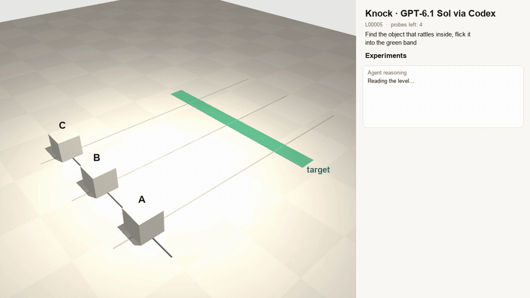
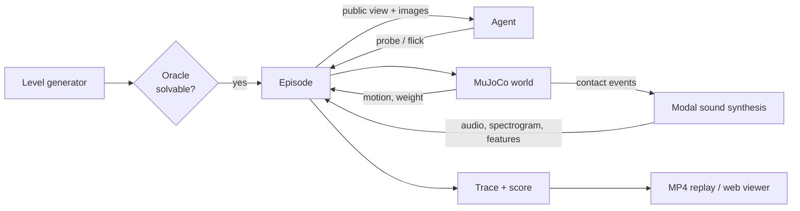

<p align="center">
  <picture>
    <source media="(prefers-color-scheme: dark)" srcset="assets/logo-dark.svg">
    
  </picture>
</p>

<p align="center">
  <b>A physics lab where AI agents have to run experiments before they act.</b><br>
  Identical-looking objects. Hidden mass, friction, materials and insides. A few probes, then one shot.
</p>

<p align="center">
  
  
  
  
</p>

<p align="center">
  
</p>
<p align="center"><sub>GPT-6.1 Sol (via Codex) taps two boxes, works out by elimination which one is hollow, weighs and pushes it to measure friction, then flicks it into the band. <a href="assets/hero.mp4">Full video with sound</a>.</sub></p>

---

## The idea

Most AI benchmarks hand the model everything it needs. The physical world doesn't: a box that looks like every other box might be hollow, full of sand, or glued to a lead weight. You only find out by **doing something to it**.

Knock turns that into a benchmark. Each level is a table with cubes that look identical. Their hidden properties differ:

| Hidden | How you can find out |
|---|---|
| mass | `lift` it (scale reading), or infer it from a `push` |
| friction | `push` it with a force you choose and see how far it slides |
| hollow vs solid | `tap` it and listen |
| loose contents (marble, beads, foam) or a glued weight | `shake` it and listen |
| material | `tap` it: metal and glass ring, wood and plastic thud |

The agent has a **probe budget**, then gets **one flick** that has to stop the right object inside a target band. Getting it right means choosing informative experiments, reading numbers and sounds correctly, and doing the physics.

A slow push alone can't separate *heavy* from *sticky*. Weighing alone says nothing about friction. Good agents notice this and pick experiments that resolve it. Great ones save probes by reasoning: "A and B don't rattle, so it's C."

## Results (dev set, 30 levels)

| Agent | Solved | Notes |
|---|---:|---|
| Oracle (knows the hidden values) | 30/30 | proves every level is solvable |
| Scripted Bayesian baseline | 29/30 | identify by elimination, then lift + push |
| **GPT-6.1 Sol** (Codex, high) | *running* | 10/12 so far, typically within a few mm |
| **GPT-6 Luna** (Codex, high) | *running* | spends probes poorly, often never measures friction |
| Random probes | 7/30 | |
| No probes | 0/30 | guessing doesn't work |

Every Codex episode is checked for tool use. An agent that runs a shell command or reads a file is flagged as `tainted`, because it could have read the answer. So far: zero tainted runs.

## How it works



- **Physics**: MuJoCo, deterministic. Sliding distances match Coulomb friction (`d = v²/2μg`) to within 0.3%, and the simulated mass of every object equals what the scale reports. The test suite enforces both.
- **Sound** is not a sound effect library. MuJoCo reports every impact (a marble hitting a wall, a steel ball striking a face), and each impact excites the object's vibration modes. A rattle is a real marble bouncing around inside a real box.
- **Fairness**: hidden information never reaches the agent (tested). Every level is oracle-verified. Probe sounds depend only on the object, not on when you probe it.

## Quick start

```bash
git clone git@github.com:srthkdev/knock.git && cd knock
uv sync

uv run knock gen --n 30 --out levels/dev                                  # oracle-verified levels
uv run knock run --agent scripted --levels levels/dev --out runs/scripted   # baselines: none | random | scripted
uv run knock run --agent codex --model gpt-6.1-sol --levels levels/dev --out runs/sol
uv run knock summary runs/*

uv run python -c "from pathlib import Path; from knock.video import render_run; \
  render_run(Path('runs/sol'), Path('out/sol.mp4'), 'GPT-6.1 Sol')"         # narrated MP4 replay with sound

uv run --group dev pytest -q
```

The Codex agent uses your local `codex` login (`codex exec`). No API key is needed.

## Build worlds from a prompt

```bash
uv run knock build "three identical boxes, one has a marble, far target"   # -> levels/custom/<slug>.json
uv run knock build --batch scripts/prompts_showcase.txt --out levels/showcase
```

A world-builder agent (Codex CLI, same sandboxed `codex exec` call as the Codex agent) fills a
`LevelSpec` (`src/knock/spec.py`, Pydantic, exported as a strict JSON schema) from the request.
Each proposal is checked and the failures are fed back until it passes (default 4 rounds):

| Check | Rule |
|---|---|
| solvable | the oracle lands the answer object in the band with a flick in range |
| unique | find tasks: exactly one object has the property |
| identifiable | tap tells hollow/solid; the rattler's first shake is >= 15 dB over floor and the loudest; heaviest/lightest differ by >= 25%; the budget covers the probes needed |
| fair | find tasks: all objects look identical |

Passing levels get a difficulty label from the none / random / scripted baselines
(`easy`: a blind flick works, `moderate`/`tricky`: probing needed, `hard`: scripted fails).
A `<slug>.report.json` with every round is written next to each level.


## Project layout

```
src/knock/
  level.py       visible layout, hidden properties, tasks, generator
  world.py       MuJoCo scenes, probes, flick
  sound.py       modal synthesis, features, spectrograms
  env.py         episodes: budgeted probes, one scored flick, traces
  oracle.py      ground-truth solver; proves levels are solvable
  spec.py        LevelSpec: LLM-facing level schema with catalogue validation
  builder.py     prompt -> validated level (Codex proposes, checks give feedback)
  render.py      offscreen scene renders
  video.py       narrated MP4 replays
  webexport.py   static data for the web app
  agents/        baselines (Bayesian physics) and the Codex agent
web/             Three.js / React app: watch replays, play levels in-browser
tests/           physics consistency, determinism, no-leak, solvability
```

## Roadmap

- [x] MuJoCo world, probes, contact-driven sound, oracle-verified levels
- [x] Baselines, Codex agent with taint detection, MP4 replays
- [ ] Web app: watch agent replays in 3D, play levels yourself with in-browser MuJoCo
- [x] Prompt-to-level: describe a world, a builder agent creates it, validators check it's fair
- [ ] FEM vibration modes and cited material constants, calibrated against real impact recordings
- [ ] Rust audio engine shared by Python and the browser (PyO3 + WebAssembly)
- [ ] Simulation-based-inference neural baseline (sbi / PyTorch)
