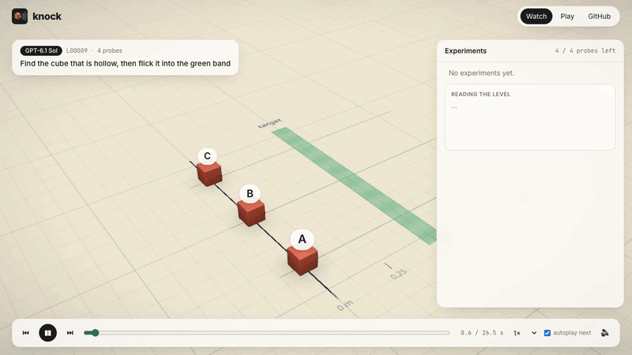
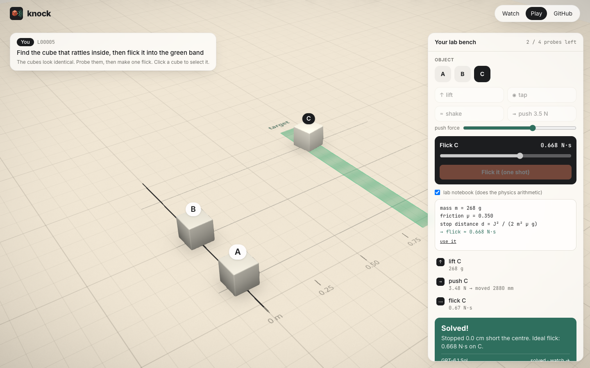
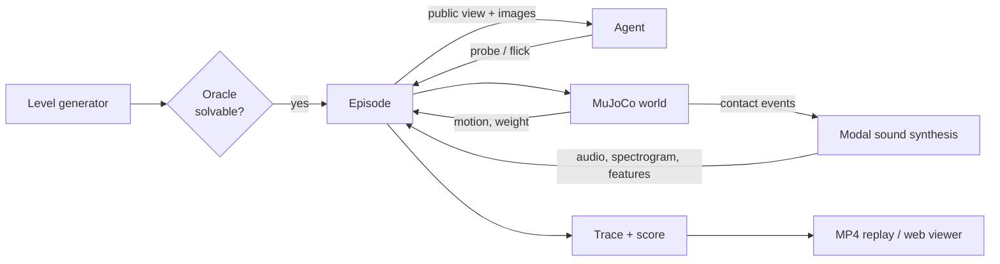

<p align="center">
  <picture>
    <source media="(prefers-color-scheme: dark)" srcset="assets/logo-dark.svg">
    
  </picture>
</p>

<p align="center">
  <b>A physics lab where AI agents have to run experiments before they act.</b><br>
  Identical-looking objects. Hidden mass, friction, materials and insides. A few probes, then one shot.
</p>

<p align="center">
  
  
  
  
</p>

<p align="center">
  
</p>
<p align="center"><sub>GPT-6.1 Sol (via Codex) taps two boxes, works out by elimination which one is hollow, weighs and pushes it to measure friction, then flicks it into the band. <a href="assets/hero.mp4">Full video with sound</a>.</sub></p>

---

## The idea

Most AI benchmarks hand the model everything it needs. The physical world doesn't: a box that looks like every other box might be hollow, full of sand, or glued to a lead weight. You only find out by **doing something to it**.

Knock turns that into a benchmark. Each level is a table with cubes that look identical. Their hidden properties differ:

| Hidden | How you can find out |
|---|---|
| mass | `lift` it (scale reading), or infer it from a `push` |
| friction | `push` it with a force you choose and see how far it slides |
| hollow vs solid | `tap` it and listen |
| loose contents (marble, beads, foam) or a glued weight | `shake` it and listen |
| material | `tap` it: metal and glass ring, wood and plastic thud |

The agent has a **probe budget**, then gets **one flick** that has to stop the right object inside a target band. Getting it right means choosing informative experiments, reading numbers and sounds correctly, and doing the physics.

A slow push alone can't separate *heavy* from *sticky*. Weighing alone says nothing about friction. Good agents notice this and pick experiments that resolve it. Great ones save probes by reasoning: "A and B don't rattle, so it's C."

## Results (dev set, 30 levels)

| Agent | Solved | Picked the right cube | Notes |
|---|---:|---:|---|
| Oracle (knows the hidden values) | 30/30 | 30/30 | proves every level is solvable |
| SBI neural baseline (PyTorch, `sbi`) | 27/30 | 30/30 | learned posterior + information-gain probing; 93% on 100 held-out levels when trained on matching audio (scripted: 89%), retraining for the v0.2 audio |
| Scripted Bayesian baseline | 29/30 | 30/30 | identify by elimination, then lift + push |
| **GPT-6.1 Sol** (Codex, high) | **26/30** | 27/30 | median miss on solved levels: **2.3 mm** |
| **GPT-6 Luna** (Codex, high) | **10/30** | 29/30 | finds the cube, then gets the physics wrong |
| Random probes | 7/30 | 26/30 | |
| No probes | 0/30 | 21/30 | guessing doesn't work |

**The two models fail in opposite ways.**
- **Sol's physics is nearly perfect, but it sometimes mishears.** Three of its four failures were the wrong cube, yet its flicks still landed within 1.5 mm of where it aimed. It misread a tap or a shake, not the mechanics.
- **Luna identifies the right cube 29 times out of 30, but solves only 10.** It spends probes weighing everything, skips measuring friction, and then guesses the impulse.

Every Codex episode is checked for tool use. An agent that runs a shell command or reads a file is flagged as `tainted`, because it could have read the answer. **0 of 60 episodes were tainted.**

Watch all 30 of Sol's episodes, narrated and with sound: [`assets/sol_all_levels.mp4`](assets/sol_all_levels.mp4) (9 min).

## Web app

<p align="center">
  
</p>

- **Watch** any agent's episode in 3D: a scrubbable timeline, the agent's reasoning typed out as it thinks, spectrograms of what it heard, the real probe sounds, and a translucent **ideal flick** ghost from the oracle racing the agent's cube.
- **Play** the same levels yourself. Pushes and flicks run on **MuJoCo compiled to WebAssembly**, using the exact model files the benchmark uses. On 24 test objects, browser and Python results are identical to the bit (`web/scripts/parity.ts`). An optional lab notebook does the arithmetic once you've weighed and pushed.
- **Leaderboard**: every level for every agent, one click from its replay.

```bash
cd web && npm install && npm run dev        # http://localhost:5173
uv run python -m knock.webexport --runs runs/sol runs/luna runs/scripted   # refresh data after new runs
```

<p align="center"></p>

## How it works



- **Physics**: MuJoCo, deterministic. Sliding distances match Coulomb friction (`d = v²/2μg`) to within 0.3%, and the simulated mass of every object equals what the scale reports. The test suite enforces both.
- **Sound** is not a sound effect library. MuJoCo reports every impact (a marble hitting a wall, a steel ball striking a face), and each impact excites the object's vibration modes. A rattle is a real marble bouncing around inside a real box.
- **Sound realism, honestly:** we checked our synthetic taps against 1,500 real impact recordings from [RealImpact](https://openaccess.thecvf.com/content/CVPR2023/html/Clarke_RealImpact_A_Dataset_of_Impact_Sound_Fields_for_Real_Objects_CVPR_2023_paper.html) (50 objects, 5 materials).
  - **Current gap:** real taps decay 2–4× faster and are about twice as bright, so a classifier trained only on our sounds is at chance on real ones.
  - **With damping refitted to the real data and a shorter room tail,** a ringing-vs-dull cutoff learned purely from synthetic sound scores 88% on real recordings (the ceiling is 90%).
  - **Next:** calibration and FEM vibration modes are in progress (see the roadmap).
- **Fairness**: hidden information never reaches the agent (tested). Every level is oracle-verified. Probe sounds depend only on the object, not on when you probe it.

## Quick start

```bash
git clone git@github.com:srthkdev/knock.git && cd knock
uv sync

uv run knock gen --n 30 --out levels/dev                                  # oracle-verified levels
uv run knock run --agent scripted --levels levels/dev --out runs/scripted   # baselines: none | random | scripted
uv run knock run --agent codex --model gpt-6.1-sol --levels levels/dev --out runs/sol
uv run knock summary runs/*

uv run python -c "from pathlib import Path; from knock.video import render_run; \
  render_run(Path('runs/sol'), Path('out/sol.mp4'), 'GPT-6.1 Sol')"         # narrated MP4 replay with sound

uv run --group dev pytest -q
```

The Codex agent uses your local `codex` login (`codex exec`). No API key is needed.

## Audio engine (Rust)

Sound synthesis lives in one Rust crate, `crates/knock-audio`, used from Python and the browser:
`synthesize` (modal resonator bank driven by contact events), `room_and_mic` (short room reverb
with a `tail_s` parameter, default 0.01 s; mic gain jitter; absolute noise floor; optional grip
rustle) and `features` (the acoustic summary agents see). All randomness comes from a PCG64 generator
seeded with a u64, so a clip depends only on its inputs.

- **Python**: optional. `uv sync --group rust` builds the `knock_audio` extension with maturin
  (needs `cargo` on `PATH`). `knock.sound` uses it automatically when installed (~11x faster);
  otherwise it falls back to numpy. Set `KNOCK_AUDIO=python` to use the numpy reference
  implementation instead. The two backends agree statistically, and `features` agrees exactly
  (`tests/test_audio_backend.py`).
- **Browser**: rebuild the ES module in `web/public/wasm/` with
  ```bash
  wasm-pack build crates/knock-audio --target web --release --out-dir ../../web/public/wasm \
      --out-name knock_audio --no-pack -- --features wasm && rm web/public/wasm/.gitignore
  ```
  ```js
  import init, * as ka from "/wasm/knock_audio.js";
  await init();
  const x = ka.render_f32(events, freqs, decay, gains, 42n, 1.4, false, ka.reverb_tail_s()); // Float32Array
  ```
  `synthesize`, `room_and_mic` and `features` take Float64Array (`features_f32` takes Float32Array).
  Events are flat `[t, J, tau, ...]` triples and seeds are `bigint`.
- **Checks**: `cargo test -p knock-audio`, `cargo run --release --example bench -p knock-audio`, and
  `uv run python scripts/bench_audio.py` (Rust vs numpy on 400 clips).


## Build worlds from a prompt

In the web app: `uv run knock serve`, open http://127.0.0.1:8765/#/build, type a world, and play it as soon as the builder agent passes validation (typically 15–30 s). From the terminal:

```bash
uv run knock build "three identical boxes, one has a marble, far target"   # -> levels/custom/<slug>.json
uv run knock build --batch scripts/prompts_showcase.txt --out levels/showcase
```

A world-builder agent (Codex CLI, same sandboxed `codex exec` call as the Codex agent) fills a
`LevelSpec` (`src/knock/spec.py`, Pydantic, exported as a strict JSON schema) from the request.
Each proposal is checked and the failures are fed back until it passes (default 4 rounds):

| Check | Rule |
|---|---|
| solvable | the oracle lands the answer object in the band with a flick in range |
| unique | find tasks: exactly one object has the property |
| identifiable | tap tells hollow/solid; the rattler's first shake is >= 15 dB over floor and the loudest; heaviest/lightest differ by >= 25%; the budget covers the probes needed |
| fair | find tasks: all objects look identical |

Passing levels get a difficulty label from the none / random / scripted baselines
(`easy`: a blind flick works, `moderate`/`tricky`: probing needed, `hard`: scripted fails).
A `<slug>.report.json` with every round is written next to each level.


## Project layout

```
src/knock/
  level.py       visible layout, hidden properties, tasks, generator
  world.py       MuJoCo scenes, probes, flick
  sound.py       modal synthesis, features, spectrograms (Rust backend + numpy fallback)
  env.py         episodes: budgeted probes, one scored flick, traces
  oracle.py      ground-truth solver; proves levels are solvable
  spec.py        LevelSpec: LLM-facing level schema with catalogue validation
  builder.py     prompt -> validated level (Codex proposes, checks give feedback)
  server.py      local API for the web app (knock serve)
  render.py      offscreen scene renders
  video.py       narrated MP4 replays
  webexport.py   static data for the web app
  agents/        baselines (Bayesian physics) and the Codex agent
crates/knock-audio/   Rust audio engine (PyO3 extension + WASM)
web/             Three.js / React app: watch, play (in-browser MuJoCo), build
tests/           physics consistency, determinism, no-leak, solvability, audio backend parity
```

## Roadmap

- [x] MuJoCo world, probes, contact-driven sound, oracle-verified levels
- [x] Baselines, Codex agent with taint detection, MP4 replays
- [x] Web app: watch agent replays in 3D, play levels yourself with in-browser MuJoCo
- [x] Prompt-to-level: describe a world, a builder agent creates it, validators check it's fair
- [ ] FEM vibration modes and cited material constants, calibrated against real impact recordings (RealImpact): in progress
- [x] Rust audio engine shared by Python and the browser (PyO3 + WebAssembly)
- [x] Simulation-based-inference neural baseline (sbi / PyTorch): calibrated posteriors, 93% on held-out levels
